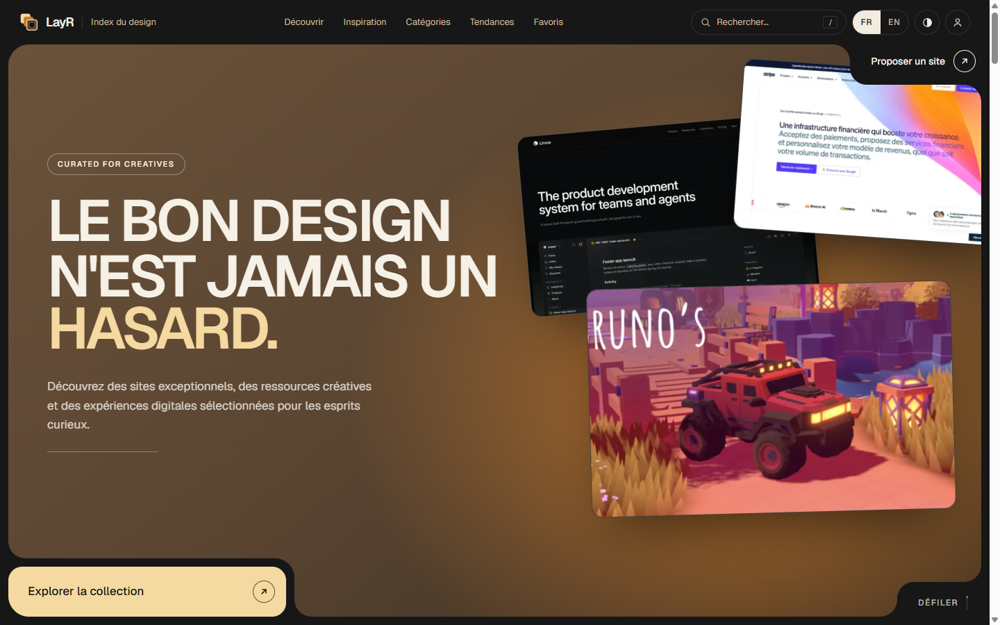
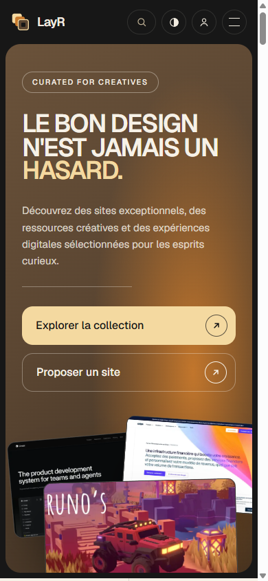

# LayR · Le bon design n'est jamais un hasard

🌐 **[layr.projectp.fr](https://layr.projectp.fr/)**

**LayR** est une plateforme bilingue (français / anglais) pour découvrir des sites web au design remarquable. Chaque site a une capture, une note éditoriale sur 10, des badges, un style, une palette et une mise en page. On cherche, on filtre, on garde ses favoris dans des collections. Les nouveaux sites arrivent par une proposition publique, analysée par l'IA puis validée par un admin.

Projet du **jour 29** du défi **30 jours, 30 projets** (Next.js, TypeScript, Postgres, Gemini, Playwright).

[](https://layr.projectp.fr/)

<p align="center">
  
</p>

## Fonctionnalités

- **Deux langues** sous `/fr` et `/en`, avec bascule sur chaque page.
- **Trois thèmes** : système, clair et sombre, avec une révélation circulaire.
- **Découvrir** : recherche (raccourci `/`), filtres par catégorie, badge, type et tri.
- **Inspiration** : 14 catégories, facettes par style, palette, mise en page et animation.
- **Fiche site** : grande capture, note sur 10, avis éditorial, infos et sites proches.
- **Catégories** et **Tendances**.
- **Favoris** : sans compte (dans le navigateur), puis synchronisés à la connexion. Collections et sites récemment consultés.
- **Comptes** maison : mots de passe hachés en scrypt, session par jeton opaque.
- **Proposer un site** : formulaire public, la proposition arrive dans l'admin.
- **Admin** : sites (créer, modifier, publier, supprimer), propositions, messages, newsletter (export CSV), taxonomie.
- **Ajout assisté par l'IA** : URL → capture Playwright → analyse Gemini → formulaire modifiable → validation. Sans clé Gemini, l'écran le dit et le formulaire manuel reste disponible.
- **Newsletter** et **contact** stockés en base.
- Images de partage Open Graph en français et en anglais.

## Lancer en local

Prérequis : Node 22.

```bash
npm install
cp .env.example .env.local
npm run db:start     # Postgres embarqué sur le port 5433 (laisser tourner)
npm run db:migrate
npm run db:seed      # environ 70 sites réels
npm run dev          # http://localhost:3000
```

Pour l'admin, ajouter son e-mail dans `ADMIN_EMAILS`, créer un compte avec cet e-mail, puis ouvrir `/fr/admin`.

## Variables d'environnement

| Variable | Rôle |
|---|---|
| `DATABASE_URL` | Base Postgres |
| `GEMINI_API_KEY` | Analyse IA des sites proposés (facultative) |
| `GEMINI_MODEL` | Modèle Gemini, `gemini-2.5-flash` par défaut |
| `ADMIN_EMAILS` | E-mails qui ont accès à l'admin, séparés par des virgules |
| `MEDIA_DIR` | Dossier des captures ajoutées depuis l'admin (volume persistant en production) |
| `NEXT_PUBLIC_SITE_URL` | URL publique, pour les liens de partage |

## Déploiement

Le `Dockerfile` construit l'application avec Chromium (pour les captures de l'admin). Au démarrage, le conteneur applique les migrations SQL, remplit le catalogue si la base est vide, puis lance Next.js sur le port 3000. Hébergé sur Coolify, avec une base Postgres et un volume sur `/data/media`.

## Stack

Next.js 16 (App Router, Cache Components) · TypeScript · Tailwind CSS 4 · Framer Motion · PostgreSQL (`pg`, migrations SQL) · Gemini (API REST) · Playwright + sharp · Docker sur Coolify.

---

## Le défi 30 jours, 30 projets

Un projet complet par jour pendant 30 jours, chacun en ligne sur son propre sous-domaine.

- 🗂️ **Tous les projets** : [projectp.fr](https://projectp.fr/)
- 💻 **Le dépôt du défi** : [github.com/PierreWZK/30DaysProjects](https://github.com/PierreWZK/30DaysProjects)
- ⬅️ **Jour précédent** : [Iron Legacy, combat 3D](https://iron.projectp.fr/)
